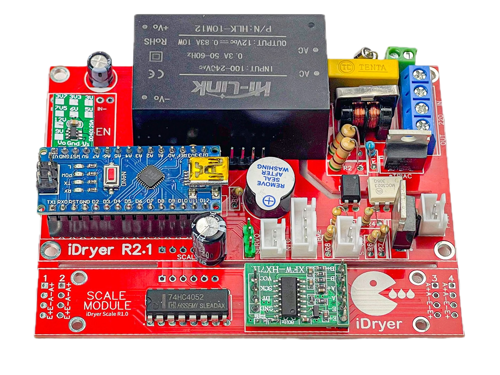

# プロジェクトについて

手軽で安価な素材から構成できるユニバーサルなフィラメント乾燥ソリューション。古いホットエンドのヒーター、不要なファン、ラジエーターなどから組み立てることができ、ケースと断熱材は家庭用品店の段ボール箱と好きな断熱材を使用できます。使用される部品のリストは想像力によってのみ制限されます。

機能：
- 最大110℃での乾燥
- 選択した温度で指定時間乾燥
- ヒーター出力を制御し、乾燥室の空気温度を十分に正確に保つ
- 指定された間隔で乾燥室を換気
- 空気温度、ヒーター温度、湿度を表示
- 乾燥完了後、ストレージモードに移行し、わずかな加熱で無期限に保管
- 選択した温度で保管
- 指定された湿度に達すると、HUMIDITY_HYSTERESISパラメータに基づいて電力を節約し、乾燥のオン/オフを切り替え
- 一般的に使用されるフィラメントのプリセット搭載
- PID自動チューニング
- スプールの計量とスプール残量の画面表示
- プリンター基板のフィラメントセンサー入力に接続するためのピンに高レベル信号を生成

ハードウェア仕様：
- 24V/220Vのほぼすべてのヒーター素子を制御
- PWMによる乾燥室ファン制御
- v4.3以前の24V動作版（12Vでも可能）
- 220V動作版
- 安価な中国製スケールモジュールを使用して、スプール重量の確度の高い結果を得る

基板設計は[jlcpcb.com](https://oshwlab.com/svet_team/idryer)に配置されています

ファームウェア仕様：
- ファームウェアファイルはすべての可能なオプションを含み、ファームウェアの設定はconfiguration.hファイルで編集可能
- Arduinoブートローダー用ファームウェア / 多くのチェックと保護にもかかわらず、最も安全とは言えません
  - v0.5.*以降、サポートは終了し、機能はテストされていません。ファームウェア内のすべての参照は遺物です
- MiniCoreコア用ファームウェア
  - ウォッチドッグタイマーが機能 / ソフトウェア障害の場合、ファームウェアを再起動
  - ロシア語と英語
  - PID制御
  - 乾燥と保管モード
  - ファン制御PWM周波数選択のサポート
  - ファン最適周波数テスト
  - HX711 ADC上の最大4つの重量モジュールをサポート
  - 1秒あたり10および80倍の重量ポーリング
  - スプール重量の画面表示
  - メニューでの容量重量入力
  - フィラメント終了の視覚、音声、フィラメントセンサー出力への警告
  - [サーボドライブのサポート](https://t.me/iDryer/361)定期的な乾燥室の換気用
  - ユーザー定義プリセット名
  - 拡張メニューと機能
  - ファームウェアセキュリティ
  
!!! warning annotate "重要！"

    :arrow_forward:</i> 操作時は、家庭用電気機器と電気加熱装置の取り扱いルールに留意してください。

    :arrow_forward:</i> 使用されているアルゴリズムは、デバイスの100%の安全性を保証することはできません。
    
    
[ファームウェア](https://github.com/pavluchenkor/iDryerController)

[Telegramグループ :fontawesome-solid-paper-plane:](https://t.me/iDryer){ .md-button }

[Contributing :material-file-edit:](https://github.com/pavluchenkor/iDryerController)
